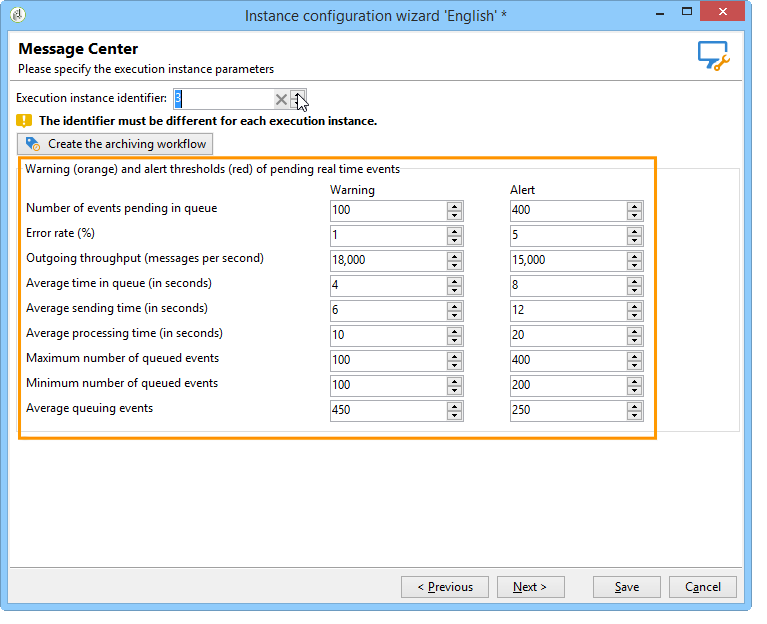

# Configurazioni aggiuntive {#mc-additional-configurations}

Questa pagina descrive ulteriori configurazioni per la messaggistica transazionale in Campaign Classic v7.

Nell’ambito della transizione da Campaign v7 a v8, il set di documentazione di Campaign Classic è stato razionalizzato e riorganizzato. Le funzioni comuni sono ora disponibili esclusivamente nel set di documentazione di Campaign v8. Per ulteriori informazioni sull&#39;eliminazione degli eventi di messaggistica transazionale e sui flussi di lavoro tecnici, consulta la [documentazione di Campaign v8](https://experienceleague.adobe.com/it/docs/campaign/campaign-v8/config/settings/transactional-msg-settings){target=_blank}.

[](https://experienceleague.adobe.com/it/docs/campaign/campaign-v8/config/settings/transactional-msg-settings){target=_blank}

## Monitorare le soglie {#monitoring-thresholds}

Puoi configurare le soglie di avviso (arancione) e le soglie di avviso (rosso) degli indicatori visualizzati nei rapporti **Livello di servizio del Centro messaggi** e **Tempo di elaborazione del Centro messaggi** (consulta [Accedere ai rapporti sulla messaggistica transazionale](https://experienceleague.adobe.com/it/docs/campaign/campaign-v8/send/real-time/event/delivery-execution){target="_blank"} (documentazione di Campaign v8).

A questo scopo, segui la procedura indicata di seguito:

1. Aprire la procedura guidata di distribuzione nell&#39;**istanza di esecuzione**.

1. Passare alla pagina **[!UICONTROL Message Center]**.

1. Utilizzare le frecce per modificare le soglie.

   

>[!NOTE]
>
>Il numero di eventi in attesa nella coda viene visualizzato nella sezione [Indicatori di sistema](../../production/using/monitoring-processes.md#system-indicators) della pagina di monitoraggio dei processi di Adobe Campaign. Per ulteriori informazioni sulla procedura guidata di distribuzione, consultare [questa sezione](../../installation/using/deploying-an-instance.md#deployment-assistant).

## Flussi di lavoro tecnici {#technical-workflows}

Prima di distribuire modelli di messaggi transazionali, è necessario assicurarsi che i flussi di lavoro tecnici sull’istanza di controllo e sulle diverse istanze di esecuzione siano stati effettivamente creati e avviati.

### Pianificazione del flusso di lavoro di archiviazione

Evitare di modificare la pianificazione del flusso di lavoro di archiviazione **&#x200B;**&#x200B;eseguita sull&#39;istanza di controllo. In caso contrario, alcuni dati di tracciamento estratti dall’istanza di esecuzione potrebbero andare persi.

Se si modifica la pianificazione del flusso di lavoro di archiviazione, è necessario modificare anche la pianificazione del flusso di lavoro di **tracciamento** nell&#39;istanza di esecuzione in modo che corrisponda alla pianificazione del flusso di lavoro di archiviazione nell&#39;istanza di controllo.

## Configurare più brand {#configuring-multibranding}

Questa sezione descrive una soluzione per configurare il tracciamento e gli URL delle pagine mirror per marchio, per i messaggi transazionali in Adobe Campaign.

### Nota di compatibilità {#compatibility-note}

Questa configurazione di branding legacy non è compatibile con il nuovo modello di [branding centralizzato](https://experienceleague.adobe.com/docs/campaign-web/v8/conf/branding/branding-gs.html?lang=it){target="_blank"} introdotto in Campaign v8.

Se l&#39;ambiente esistente utilizza questa configurazione legacy, non è possibile migrare direttamente al nuovo modello di branding centralizzato. Per adottare il nuovo sistema è necessaria una reimplementazione completa delle impostazioni di branding.

### Prerequisiti {#prerequisites}

* Tutti gli host devono essere aggiunti al file di configurazione dell&#39;istanza (`config-<instance>.xml`).
* A ogni marchio deve essere assegnato un sottodominio.
* Se il tracciamento web viene eseguito su pagine HTTPS, è necessario disporre di un certificato HTTPS per tutti i brand.

Per configurare il multibranding, è necessario configurare sia le istanze di esecuzione che l’istanza di controllo.

### Istanza di esecuzione {#execution-instance}

Nelle istanze di esecuzione, segui i passaggi seguenti:

1. Crea un account esterno per marchio.

   >[!NOTE]
   >
   >Scopri come creare un account esterno di tipo istanza di esecuzione in [questa sezione](../../message-center/using/configuring-instances.md#control-instance).

1. Estendere lo schema nms:extAccount per aggiungere l&#39;URL di tracciamento:

   ```
   <attribute advanced="true" desc="URL of the tracking servers" label="Tracking server URL"
   length="100" name="trackingURL" type="string"/>
   ```

   >[!NOTE]
   >
   >Scopri come estendere uno schema esistente nella sezione [Estensione di uno schema](../../configuration/using/extending-a-schema.md).

1. Modificare il modulo nms:extAccount:

   ```
   <container label="Message domain branding" type="frame">
        <static type="help"> These parameters are used to override the DNS alias and addresses used during message delivery. When not populated, the values of the 'NmsServer_MirrorPageUrl' and 'NmsEmail_DefaultErrorAddr' options are used.</static>
        <input xpath="@mirrorURL"/>
        <input xpath="@trackingURL"/>
        <input img="nms:sendemail.png" menuId="deliveryMenuBuilder" type="scriptEdit">
               xpath="errorAddress"/>
      </container>
   ```

1. Modificare le opzioni NmsTracking_OpenFormula e NmsTracking_ClickFormula per utilizzare il conto esterno anziché un&#39;opzione globale.

   Per eseguire questa operazione, sostituisci:

   ```
   <%@ include option='NmsTracking_ServerUrl' %>
   ```

   con:

   ```
   <%@ value object="provider" xpath="@trackingURL" %>
   ```

   >[!IMPORTANT]
   >
   >Queste modifiche potrebbero causare conflitti durante l&#39;aggiornamento. Potrebbe essere necessario unire manualmente queste formule con la nuova versione.

### Istanza di controllo {#control-instance}

Nell’istanza di controllo, devi collegare i modelli di consegna e gli account esterni.

A questo scopo, segui la procedura indicata di seguito:

1. Crea un account esterno per brand con lo stesso nome interno definito nell&#39;[istanza di esecuzione](#execution-instance) (passaggio 1).

1. Crea un modello di consegna per marchio. Consulta la [documentazione di Campaign v8](https://experienceleague.adobe.com/docs/campaign/campaign-v8/send/create-templates.html?lang=it){target="_blank"}.

1. In **[!UICONTROL Properties]** del modello di consegna, imposta il routing sull&#39;account esterno del brand.
